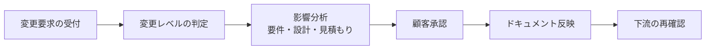

> ステータス: **draft**

{/* TODO: 各セクションの記入例を実際の内容に置き換えてください */}

## 背景

{/* TODO: 顧客がこのプロジェクトを始める背景・現状の課題を記載 */}

例: 現在、〇〇業務は Excel と紙で運用されており、月間約 40 時間の転記作業が発生している。担当者の退職に伴い属人化の解消が急務となっている。

## 目的

{/* TODO: プロジェクトで達成したいゴールを定量的に記載 */}

例: 〇〇業務を Web システム化し、転記作業を月間 5 時間以下に削減する。

### 成功基準

{/* TODO: 「何をもって成功とするか」を、確認方法・時期とあわせて記載。KPI ツリーを作成する場合は KPI-xxx を併記 */}

| 指標 | 現状 | 目標 | 確認方法・時期 |
| --- | --- | --- | --- |
| 例: 転記作業時間 | 例: 月間 40 時間 | 例: 月間 5 時間以下 | 例: リリース 3 ヶ月後に業務担当へヒアリング |

## スコープ

### 対象範囲

{/* TODO: 今回の開発に含まれるものを箇条書きで記載 */}

- 例: 受注管理機能(登録・検索・帳票出力)

### 対象外

{/* TODO: 今回の開発に含まれないものを明記(見積もりの前提になります) */}

- 例: 既存データの移行作業(別途見積もり)
- 例: スマートフォンアプリ

## ステークホルダー・体制

{/* TODO: 利用者・運用担当・情報システム・法務など、要求の発生源になる関係者を漏れなく記載 */}

| 役割 | 所属 | 氏名 | 責務 |
| --- | --- | --- | --- |
| プロジェクトオーナー | 顧客 | {/* TODO */} | 最終意思決定・要求と変更の承認 |
| 窓口担当 | 顧客 | {/* TODO */} | 要求整理・受け入れ確認 |
| 例: 利用部門代表 | 顧客 | {/* TODO */} | 現場の要望の提供・受け入れテストの実施 |
| PM | 自社 | {/* TODO */} | 進行管理・品質管理 |
| 開発リード | 自社 | {/* TODO */} | 技術選定・実装統括 |

## マイルストーン

{/* TODO: 大日程を記載。詳細な WBS は見積もりセクションに記載 */}

| フェーズ | 期間 | 成果物 |
| --- | --- | --- |
| 要件定義 | YYYY/MM 〜 YYYY/MM | 要件定義書(承認) |
| 設計 | YYYY/MM 〜 YYYY/MM | 設計書(承認) |
| 開発 | YYYY/MM 〜 YYYY/MM | 動作するシステム |
| テスト・受け入れ | YYYY/MM 〜 YYYY/MM | 検収 |
| リリース | YYYY/MM | 本番稼働 |

## 前提条件・制約

{/* TODO: 予算上限、納期、既存システム連携、法規制などの制約を記載 */}

- 例: 予算上限は〇〇万円(税抜)
- 例: 〇〇年〇月の繁忙期前にリリース必須

## 変更管理

{/* TODO: 顧客と合意した変更管理手順に合わせて修正 */}

合意済みの要求・要件への変更は、次の手順で扱う。変更の記録は[要求定義](/requirements/user-requirements)の「変更履歴」に残す。

| 変更レベル | 例 | 対応方針 |
| --- | --- | --- |
| 目的・成功基準の変更 | 例: 対象業務の追加、目標値の見直し | 本ドキュメントまで戻り、要求・要件・設計・見積もりを再整理 |
| 要求・業務の変更 | 例: 要求の追加・優先度変更、業務手順の変更 | 要求定義まで戻り、影響する要件・設計・見積もりを更新 |
| 要件・実現手段の変更 | 例: 性能条件の変更、データ項目の追加 | システム要件定義まで戻り、影響する設計・見積もりを更新 |

- 例: 変更要求は窓口担当から書面(メール可)で受け付ける
- 例: 工数・納期に影響する変更は、影響分析の結果を提示し、顧客承認後に着手する
- 要件は妥当で実装が満たしていない場合は、変更ではなく不具合として是正する
