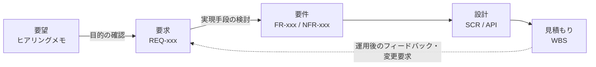

> ステータス: **draft**

顧客の要望を、背景にある目的を確認したうえで「実現したいこと(要求)」として整理する。実現手段はここでは決めない(実現手段は[システム要件定義](/requirements/system-requirements)と[設計](/design)で扱う)。

## 要望・要求・要件の区別

要望をそのまま実装対象にしない。要望 → 要求 → 要件の順に具体化する。

| 区分 | 意味 | 例 | 記載場所 |
| --- | --- | --- | --- |
| 要望 | 望み・期待・困りごと(漠然としていてよい) | 受注の問い合わせにすぐ答えたい | ヒアリングメモ |
| 要求 | 要望の目的を確認し、実現したいこととして整理したもの | 受注情報を一覧で確認し、キーワードで検索したい | 要求一覧(REQ-xxx) |
| 要件 | 要求を実装・評価できる水準まで具体化したもの | 受注を顧客名・受注番号・期間で検索できる | システム要件定義(FR-xxx / NFR-xxx) |

## 要求一覧

{/* TODO: ヒアリング結果を追記。IDは REQ-001 から連番で採番し、欠番を再利用しないこと */}

| ID | 要求 | 発生源 | 根拠(目的) | 優先度 | 状態 | 備考 |
| --- | --- | --- | --- | --- | --- | --- |
| REQ-001 | 例: 受注情報を一覧で確認し、キーワードで検索したい | 営業部 | 例: 顧客からの問い合わせへの回答時間を短縮する | Must | 合意 | 現状は Excel を目視検索 |
| REQ-002 | 例: 月次の売上帳票を PDF で出力したい | 経理部 | 例: 月次締めの転記作業をなくす | Must | 合意 | 既存帳票のレイアウト踏襲 |
| REQ-003 | 例: 外出先からスマートフォンで受注状況を確認したい | 営業部 | 例: 帰社せずに顧客へ回答する | Could | 候補 | 閲覧のみで可 |
| REQ-004 | 例: 営業時間中は停止せず、顧客情報を社外に漏らさずに利用したい | 情報システム部・社内セキュリティ規程 | 例: 業務継続と顧客情報の保護 | Must | 合意 | 非機能要件の発生源 |

- 発生源: 要求を出した部門・人物のほか、法令・契約・社内規則・既存システムの制約も記載する
- 根拠(目的): 「なぜ必要か」を記載する。根拠を書けない要求は目的と手段が混ざっていないか確認する

### 優先度の定義(MoSCoW)

| 優先度 | 意味 |
| --- | --- |
| Must | 必須。これがないとプロジェクトの目的を達成できない |
| Should | 重要。原則対応するが、納期・予算次第で調整可能 |
| Could | あれば望ましい。余力があれば対応 |
| Won't | 今回は対応しない(スコープ外として記録) |

### 状態の定義

| 状態 | 意味 |
| --- | --- |
| 候補 | ヒアリングで抽出した段階。顧客との合意前 |
| 合意 | 顧客と合意済み。要件化・設計・見積もりの前提とする |
| 取り下げ | 対応しないと決定(行は消さず、理由を備考に残す) |

## 要求分析の確認観点

要求一覧を確定する前に、各要求について以下を確認する。

- プロジェクトの目的([プロジェクト概要](/requirements/project-overview))のどれに対応しているか
- 本当に必要か。既存の手順・帳票・承認をそのまま前提にしていないか(簡素化できないか)
- 手段が目的化していないか(例: 「PDF で提出したい」の目的は「申請者の負担軽減」ではないか)
- システム化以外の実現手段(業務手順の変更・運用での対応・既存システムの利用)と比較したか
- 要求同士に重複・矛盾がないか(矛盾する場合は優先度と調整方針を備考に記載)
- 実現可能か。検証可能か(受け入れ基準を書けるか)
- 法令・契約・社内規則と整合しているか

## 受け入れ基準

{/* TODO: Must 要求ごとに「何をもって満たされたとするか」を記載 */}

### REQ-001 の受け入れ基準

- 例: 受注一覧画面で顧客名・受注番号による部分一致検索ができる
- 例: 1,000 件のデータで検索結果が 3 秒以内に表示される

## ヒアリングメモ

{/* TODO: 日付・参加者・確認事項を時系列で記録。要望は顧客の言葉のまま残す */}

| 日付 | 参加者 | 内容 |
| --- | --- | --- |
| YYYY/MM/DD | {/* TODO */} | 初回ヒアリング |

## 未確定事項

{/* TODO: 顧客に確認中の項目を記載し、確定したら要求一覧へ反映して行を消す */}

- [ ] 例: 帳票レイアウトの最終版の受領待ち(期限: YYYY/MM/DD)

## 変更履歴

{/* TODO: 状態が「合意」になった要求を変更・追加・取り下げした場合に記録する。手順はプロジェクト概要の「変更管理」を参照 */}

| 日付 | 対象 ID | 変更内容 | 変更理由 | 影響範囲 | 承認者 |
| --- | --- | --- | --- | --- | --- |
| YYYY/MM/DD | 例: REQ-003 | 例: 優先度を Could から Should へ変更 | 例: 環境変化(営業体制の変更) | 例: FR 追加、SCR 追加、WBS 再見積もり | {/* TODO */} |

変更理由は次の区分を添えて記載する。

| 区分 | 内容 |
| --- | --- |
| 環境変化 | 法令・業務・市場・利用環境の変化への対応 |
| 学習 | 試作・運用・利用者の声から得た新たな知見の反映 |
| 不備の訂正 | 当初の要求定義の漏れ・誤りの訂正(再発防止をヒアリング手順へ反映する) |
