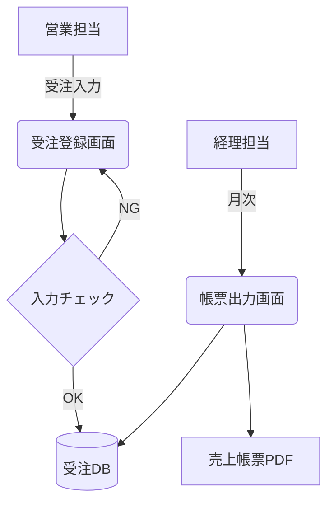

> ステータス: **draft**

[要求定義](/requirements/user-requirements)の各要求を、実装・評価できる水準のシステム要件へ具体化する。各要件には対応する要求 ID を必ず記載する。

すべての要求がシステム要件になるわけではない。業務手順の変更や運用で実現する要求は、要求一覧の備考にその旨を記載し、ここには含めない。

## 要件文の書き方

要件文は次の条件を満たすように記述する。

| 条件 | 確認内容 |
| --- | --- |
| 必要性 | 対応する要求(REQ-xxx)がある |
| 一意性 | 読み手によって解釈が分かれない |
| 実現可能性 | 予算・納期・技術の制約内で実現できる |
| 検証可能性 | 満たしたかどうかをテスト・レビューで判定できる |
| 無矛盾 | 他の要件・法令・社内規則と矛盾しない |
| 適切な粒度 | 1 文に 1 要件。設計の自由度を不必要に縛らない |

| 悪い例 | 問題点 | 良い例 |
| --- | --- | --- |
| システムは使いやすいこと | 「使いやすい」の基準がなく検証できない | 利用者は初回ログイン後、3 分以内に受注登録画面へ到達できる |
| 関連法令を遵守すること | どの法令のどの義務を、どの機能・データで満たすか不明 | 顧客情報の閲覧・更新・出力の操作ログを 1 年間保存する(個人情報保護法の安全管理措置) |
| 検索は高速であること | 条件・数値がない | 受注 10 万件の状態で、検索結果を 3 秒以内に表示する |

## 機能要件

{/* TODO: IDは FR-001 から連番で採番。対応要求のない機能要件は原則作らない */}

| ID | 機能要件 | 対応要求 | 優先度 | 検証方法 |
| --- | --- | --- | --- | --- |
| FR-001 | 例: 受注の登録・編集・削除ができる | REQ-001 | Must | 例: 結合テスト |
| FR-002 | 例: 受注を顧客名・受注番号・期間で検索できる | REQ-001 | Must | 例: 結合テスト |
| FR-003 | 例: 月次売上帳票を PDF 形式で出力できる | REQ-002 | Must | 例: 経理部による帳票レビュー |

### 機能詳細

{/* TODO: 複雑な機能は個別に詳細を記載。入力・処理・出力・例外時の扱いを明記 */}

#### FR-002: 受注検索

- 検索条件: 顧客名(部分一致)、受注番号(完全一致)、受注日(期間指定)
- 検索結果はページネーション表示(1 ページ 50 件)
- 例外: 該当 0 件の場合は「該当する受注がありません」と表示

## 非機能要件

{/* TODO: IDは NFR-001 から連番で採番。カテゴリはIPA非機能要求グレードを参考に。対応要求を必ず記載 */}

| ID | カテゴリ | 非機能要件 | 対応要求 | 検証方法 |
| --- | --- | --- | --- | --- |
| NFR-001 | 性能 | 例: 通常操作の画面応答は 3 秒以内 | REQ-001 | 例: 性能テスト |
| NFR-002 | 可用性 | 例: 営業時間帯(平日 9-18 時)の稼働率 99.5% 以上 | REQ-004 | 例: 月次の稼働実績レポート |
| NFR-003 | セキュリティ | 例: 通信は TLS 1.2 以上で暗号化。パスワードはハッシュ化保存 | REQ-004 | 例: 脆弱性診断・設定レビュー |
| NFR-004 | 運用・保守 | 例: 日次で自動バックアップを取得し 30 日分保持 | REQ-004 | 例: リストア手順の実機確認 |

法令・契約・社内規則に基づく要件は、対象となる条項・義務、反映先の機能・データ、残す記録(ログ・証跡)まで具体化して記載する。

## ユースケース

{/* TODO: 主要な業務フローを mermaid で図示 */}

## 用語定義

{/* TODO: 顧客固有の業務用語を定義 */}

| 用語 | 定義 |
| --- | --- |
| 例: 受注 | 顧客からの正式な注文。見積もり段階のものは含まない |
